[简体中文](./README.md) · [Website](https://wenti.lei6393.com) · [GitHub](https://github.com/SuperMarioYL/wenti)

<picture>
  <source media="(max-width: 600px) and (prefers-color-scheme: dark)" srcset="./assets/presentation/hero-mobile-dark.svg">
  <source media="(max-width: 600px)" srcset="./assets/presentation/hero-mobile-light.svg">
  <source media="(prefers-color-scheme: dark)" srcset="./assets/presentation/hero-dark.svg">
  
</picture>

# wenti

**Make editorial feedback repeatable across drafts.**

Wenti packages an editorial voice card, examples and a four-dimension rubric for Chinese long-form writing. It offers local heuristic scoring and optional model-based scoring or rewriting.

## Why use it

Repeatedly restating a preferred writing direction makes drafts harder to compare. A named pack and explicit rubric let a writer reuse the same criteria while retaining editorial judgment.

- **Reuse named criteria** — The same pack can be selected for each draft.
- **Inspect the rubric** — Dimension weights and local rules are source visible.
- **Run without a model** — Explicit dry-run keeps scoring local.

## Architecture

<picture>
  <source media="(max-width: 600px) and (prefers-color-scheme: dark)" srcset="./assets/presentation/architecture-mobile-dark.svg">
  <source media="(max-width: 600px)" srcset="./assets/presentation/architecture-mobile-light.svg">
  <source media="(prefers-color-scheme: dark)" srcset="./assets/presentation/architecture-dark.svg">
  
</picture>

The pack loader reads voice-card metadata and examples. score_draft chooses an explicit dry-run heuristic or a configured model path. Four sub-scores are combined by rubric weights and accompanied by suggestions. rewrite uses the selected pack through its own path.

| Component | Responsibility |
| --- | --- |
| `Editorial pack` | wenti/packs |
| `Draft text` | User-authored input |
| `Rubric scorer` | wenti/scorer/score.py |
| `Score / suggestions` | Four dimensions and total |

## Install and quickstart

Build with the version declared in the repository manifest. Run the example from the repository root.

```bash
git clone https://github.com/SuperMarioYL/wenti.git
cd wenti
uv venv .venv
uv pip install --python .venv/bin/python -e .
source .venv/bin/activate
```

The example includes an original Chinese scene and runs score_draft with dry_run=True so no credentials or network are used.

```bash
.venv/bin/python examples/presentation-demo.py
```

## Recorded demo

<picture>
  <source media="(max-width: 600px) and (prefers-color-scheme: dark)" srcset="./assets/presentation/process-mobile-dark.svg">
  <source media="(max-width: 600px)" srcset="./assets/presentation/process-mobile-light.svg">
  <source media="(prefers-color-scheme: dark)" srcset="./assets/presentation/process-dark.svg">
  
</picture>

The recorded score is a deterministic heuristic result for the supplied text.

```text
{
  "input": "清晨，菜市场的灯还亮着。老周把白菜码在摊位上，水汽从叶脉间慢慢散开。\n\n街道醒了。\n\n他为什么还留在这里？女儿的信压在棋盘下面，时间在纸角留下浅浅的褶皱。",
  "pack": "sanlian",
  "dry_run": true,
  "sub_scores": {
    "句式": 2.0,
    "用词": 4.1,
    "节奏": 2.5,
    "视角": 2.5
  },
  "total": 2.83
}
```

The complete command and output are recorded in [docs/demo-results.json](./docs/demo-results.json). Inputs and reproduction code are included in the repository.


The existing recording is retained for context; the text example above documents the reproducible scenario.

## Usage

The CLI exposes the following operations. Commands after the example use your own paths or identifiers.

```bash
wenti list
wenti score draft.md --pack sanlian --dry-run --json
# Model-backed rewrite uses the configured endpoint:
wenti rewrite draft.md --pack sanlian
```

## Configuration

WENTI_BASE_URL and WENTI_API_KEY enable the model path; WENTI_MODEL selects its model. --dry-run forces local scoring even when credentials exist. rubric.yaml weights sentence structure and wording at 0.3 each, rhythm and perspective at 0.2 each.

## Integrations and responsibilities

<picture>
  <source media="(max-width: 600px) and (prefers-color-scheme: dark)" srcset="./assets/presentation/integrations-mobile-dark.svg">
  <source media="(max-width: 600px)" srcset="./assets/presentation/integrations-mobile-light.svg">
  <source media="(prefers-color-scheme: dark)" srcset="./assets/presentation/integrations-dark.svg">
  
</picture>

The following routes are implemented in the source. Choose the input that matches your task and keep the resulting artifact with your project.

| Route | Implemented role |
| --- | --- |
| Chinese draft | Local text input |
| sanlian pack | Bundled project editorial profile |
| Local heuristics | Explicit --dry-run route |
| Compatible model API | Optional scoring / rewriting |

## Limits and next steps

- The heuristic rewards specific wording and sentence/paragraph features. Its score is not an objective measure of writing quality or an independent editorial assessment.
- The bundled sanlian label names a project pack; this page does not claim endorsement by a publication.
- The offline demo scores an original short fixture and does not demonstrate a model rewrite or improved reader outcomes.

Additional packs and cross-draft consistency tools remain future work. Evaluate any new rubric with independent editorial feedback rather than only its own examples.

## License and contributions

See [LICENSE](./LICENSE). When reporting an issue, include a minimal input, the command, and the observed output.
